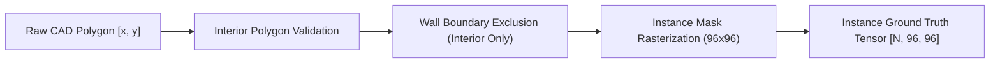
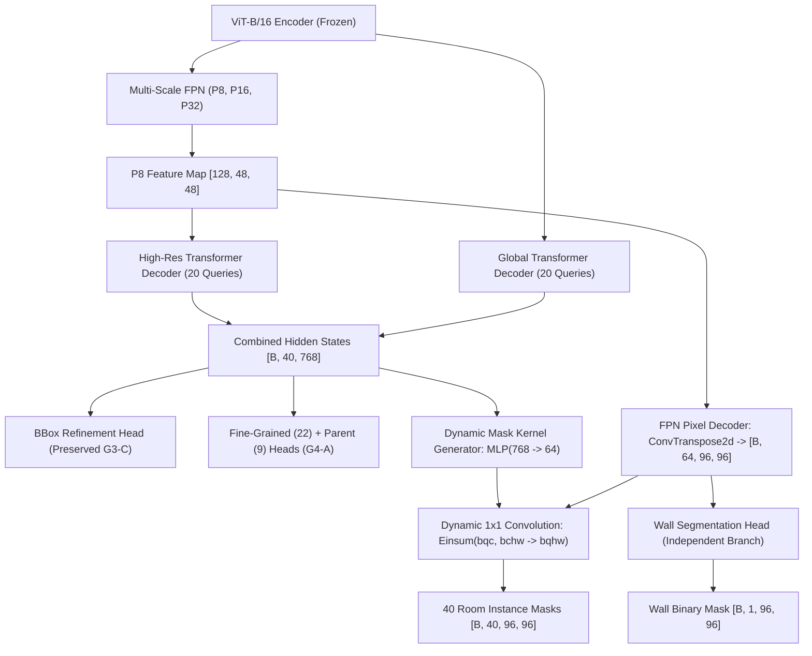

# Experiment G4-B Technical Specification: Dynamic Instance Masks

> [!IMPORTANT]
> **Status**: Specification & Architectural Design (Pre-implementation).
> Scheduled to proceed only after Experiment G4-A completes, is evaluated across all metrics, and its checkpoint is frozen.

---

## 1. Problem Definition & Motivation

In Experiment G3-C, single-layer iterative bounding box refinement established high Hungarian IoU ($0.5466$) on rectangular rooms, but exhibited a **36.7% regression rate on irregular open spaces**. 

Axis-aligned bounding boxes intrinsically cannot represent:
- **L-shaped rooms**: Living-dining combinations, wraparound kitchens.
- **T-shaped or alcove layouts**: Corridors with recessed entries, study alcoves.
- **Concave room geometries**: Standard bounding box area ($W \times L$) severely overestimates physical floor area by including exterior walls, adjacent rooms, or empty courtyards.

**Experiment G4-B** introduces a **Dynamic Instance Mask Head** to predict pixel-accurate room interiors, enabling non-convex polygon extraction and true architectural dimension recovery.

---

## 2. Ground-Truth Data Pipeline Specifications

### Core Integrity Requirements:
1. **Interior Region Only**: Room masks represent only the habitable/interior floor area. Wall thicknesses (structural outer walls and partition interior walls) are strictly excluded from room instance masks.
2. **Instance Uniqueness**: Each room instance in a layout receives its own dedicated binary ground truth mask $M_i \in \{0, 1\}^{H \times W}$.
3. **Adjacent Room Separation**: When two rooms share an interior partition wall, their ground truth masks must not overlap. The separating wall pixels remain $0$ in both room masks.
4. **Doorway Integrity**: Door openings and visual thresholds must not merge distinct room instances.
5. **Exact Metric Ground Truth**: Each room instance retains its ground-truth polygon vertices and printed metric floor area ($\text{m}^2$) from the dataset generator.

---

## 3. Dynamic Instance Mask Architecture

G4-B builds directly upon the frozen ViT backbone, FPN, and two-scale queries of G3-C/G4-A:

### Architectural Principles:
1. **Dynamic Kernel Formulation & Dimensions**:
   The pixel decoder upsamples the $P_8$ feature map ($128 \times 48 \times 48$) to produce high-resolution spatial feature map $F \in \mathbb{R}^{B \times 64 \times 96 \times 96}$. Each query $q$ generates a 64-dimensional dynamic kernel weight $w_q \in \mathbb{R}^{64}$ and scalar bias $b_q \in \mathbb{R}$ via an MLP projection ($\text{Linear}(768, 256) \rightarrow \text{ReLU} \rightarrow \text{Linear}(256, 65)$):
   $$M_q(x, y) = \sigma\left( \sum_{c=1}^{64} w_{q, c} F_c(x, y) + b_q \right)$$
   For 40 queries ($Q=40$) and a $96 \times 96$ feature map, this dynamic $1 \times 1$ convolution produces 40 individual $96 \times 96$ instance mask predictions per layout: $[B, 40, 96, 96]$.

2. **Geometric Ground-Truth Preservation (Interior Polygons)**:
   Room-instance ground-truth masks must be rasterized directly from the original CAD interior polygon vertices stored in the dataset annotations (`sample['rooms'][i]['polygon']`).
   > [!IMPORTANT]
   > Do **NOT** generate room masks by simply subtracting wall segmentation from the floor-plan image. Subtraction heuristics create noisy, jagged perimeters and artificially bridge adjacent rooms across door openings. Direct polygon rasterization guarantees that interior non-convex boundaries, partition gaps, and exact square meterage are preserved with mathematical ground truth.

3. **Dual Geometry Representation**:
   - The **Bounding Box Head** (`bbox_head_0` + `bbox_head_1`) is **fully preserved** to provide spatial anchor localization, initial aspect ratio, and fast CAD bounding fallback.
   - The **Dynamic Instance Mask Head** predicts fine-grained interior boundary geometry.

4. **Decoupled Wall vs. Room Supervision**:
   - The wall segmentation head ($\mathcal{L}_{\text{wall}}$) supervises structural wall masks.
   - The dynamic mask head ($\mathcal{L}_{\text{inst\_mask}}$) supervises room interior instances matched via Hungarian assignment.

---

## 4. Multi-Task Loss Formulation

$$\mathcal{L}_{\text{G4B}} = \mathcal{L}_{\text{G4A\_class}} + 5.0 \mathcal{L}_{\text{bbox\_1}} + 2.0 \mathcal{L}_{\text{giou\_1}} + 2.5 \mathcal{L}_{\text{aux\_bbox\_0}} + 1.0 \mathcal{L}_{\text{aux\_giou\_0}} + 2.5 \mathcal{L}_{\text{wall\_mask}} + 4.0 \mathcal{L}_{\text{inst\_mask}} + 0.1 \mathcal{L}_{\text{scale}}$$

Where the dynamic instance mask loss combines Binary Cross-Entropy and Dice loss across matched queries:
$$\mathcal{L}_{\text{inst\_mask}} = \frac{1}{N_{\text{matched}}} \sum_{i \in \text{matched}} \left[ \text{BCE}(\sigma(M_i), M_i^{\text{gt}}) + \text{Dice}(\sigma(M_i), M_i^{\text{gt}}) \right]$$

---

## 5. End-to-End Geometric CAD Extraction Pipeline

Following room detection and mask prediction, HomeVerse extracts CAD-ready polygon boundaries:

1. **Binarization & Thresholding**:
   $$M_{\text{bin}} = (M_i > 0.5) \land (\text{WallMask} < 0.3)$$
   Snaps room interior edges against predicted wall boundaries to prevent bleeding into partition walls.
2. **Contour Extraction**:
   Extract external boundary contour points via OpenCV `cv2.findContours(M_bin, cv2.RETR_EXTERNAL, cv2.CHAIN_APPROX_SIMPLE)`.
3. **Polygon Simplification**:
   Apply Douglas-Peucker algorithm (`cv2.approxPolyDP`) with tolerance $\epsilon = 0.015 \times \text{perimeter}$ to eliminate raster pixel aliasing and produce clean architectural vertices.
4. **Metric Area Calculation (Shoelace Formula)**:
   $$\text{Area}_{\text{px}} = \frac{1}{2} \left| \sum_{k=0}^{n-1} (x_k y_{k+1} - x_{k+1} y_k) \right|$$
   $$\text{Area}_{\text{m}^2} = \frac{\text{Area}_{\text{px}}}{(\text{Scale}_{\text{px/m}})^2}$$
5. **Dimension Verification**:
   Calculate minimum oriented bounding box (OBB) along principal axes of the polygon for non-axis-aligned rooms.

---

## 6. Implementation & Evaluation Requirements

To ensure rigorous validation of geometric interior recovery without conflating disparate tasks, G4-B enforces four core implementation requirements:

### Requirement 1: Preservation of Instance Identity
Two adjacent rooms must receive separate, non-overlapping masks even when sharing an interior partition wall or exhibiting identical visual flooring/style appearance.
- **Interior-Only Mask**: The separating partition wall pixels must remain strictly $0$ in both adjacent masks.
- **Threshold Snapping**: Mask edges snap to the predicted wall segmentation mask ($M_{\text{bin}} = (M_i > 0.5) \land (\text{WallMask} < 0.3)$), preventing door openings or open boundaries from accidentally merging distinct adjacent spaces.

### Requirement 2: Independent Mask Quality Evaluation Suite
Mask quality must be evaluated directly and independently rather than relying on bounding-box IoU or wall segmentation Dice:
1. **Instance Mask Dice**: Harmonic mean of predicted vs. ground-truth interior overlap across all matched instances.
2. **Instance Mask IoU**: Jaccard index per room instance.
3. **Boundary F1**: Contour distance precision and recall within a 2-pixel tolerance buffer around room perimeter vertices.
4. **Per-Room Mask Precision & Recall**: Pixel-level precision/recall evaluated per room query.
5. **Small-Room Mask Recall**: Strict mask recovery specifically for rooms $< 6\,\text{m}^2$.
6. **Non-Convex Room Mask IoU**: Isolated benchmark on L-shaped, T-shaped, and irregular open layouts ($N=142$ in unseen test set).

### Requirement 3: True Polygonal Area vs. Bounding-Box Area Benchmark
To resolve the fundamental limitation of axis-aligned bounding boxes on irregular layouts, G4-B will report:
- **Mask Polygonal Area Error (%)**: Derived via the Shoelace formula on simplified contour vertices.
- **Bounding-Box Area Error (%)**: Derived via standard $W \times L$.
- Proving empirical area accuracy gains on L-shaped and connected living/dining zones where $W \times L$ fails.

### Requirement 4: Dual Geometry Preservation
The bounding-box refinement branch from G3-C is retained and evaluated alongside the mask branch. Mask improvements must not degrade box-level localization or scale calibration.
