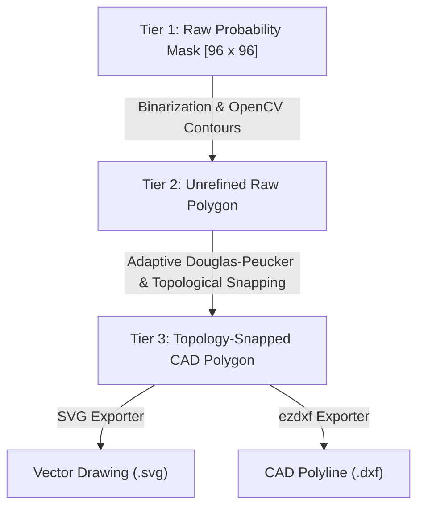

# Experiment G4-C Technical Specification: Polygon Boundary Refinement & CAD Vectorization

> [!IMPORTANT]
> **Status**: Approved Specification & Implementation Milestone.
> **Role**: Converts G4-B dynamic instance masks into valid, editable CAD geometry (DXF & SVG) through a deterministic, topology-aware polygon extraction pipeline.

---

## 1. Problem Statement & Objectives

While **Experiment G4-B** successfully moved HomeVerse beyond rectangular approximations by predicting pixel-accurate dynamic instance masks ($0.7873$ Mask IoU, $0.8489$ Boundary F1), raster masks cannot be directly imported into standard architectural CAD software (AutoCAD, Revit, SketchUp, Blender, Rhino).

Direct raster-to-vector conversion typically suffers from:
1. **Pixel aliasing & staircasing**: Diagonal and curved walls become jagged staircases.
2. **Double partition walls / boundary misalignment**: Adjacent rooms independently trace opposite sides of the same partition wall, creating artificial voids, overlapping slivers, or inconsistent wall thicknesses.
3. **Loss of architectural features**: Aggressive polyline decimation rounds off sharp $90^\circ$ corners and eliminates recessed entries, alcoves, and L-shaped room legs.
4. **Invalid non-manifold geometry**: Self-intersecting boundaries, collinear degenerate edges, and inverted hole orientations.

**Experiment G4-C** establishes an end-to-end, deterministic vectorization and topology refinement pipeline to produce clean, valid closed polylines with verified metric scale and round-trip DXF/SVG export.

---

## 2. The 3-Tier Immutable Representation Architecture

To measure the exact geometric contribution of each processing stage without destroying source predictions, HomeVerse enforces **three strictly isolated representations**:

1. **Tier 1 — Raw Mask Representation**:
   - The predicted dynamic mask logit/probability map $M_q \in [0, 1]^{96 \times 96}$ from G4-B.
   - Never modified, decimated, or overwritten.

2. **Tier 2 — Unrefined Raw Contour Polygon**:
   - Discrete pixel-level perimeter extracted directly via `cv2.findContours(binary, cv2.RETR_EXTERNAL, cv2.CHAIN_APPROX_NONE)`.
   - Scaled to the native coordinate space (e.g. $1024 \times 1024$).
   - Serves as the unadulterated baseline for measuring post-processing geometric drift.

3. **Tier 3 — Topology-Snapped & Simplified CAD Polygon**:
   - Simplified using adaptive corner-preserving Douglas-Peucker.
   - Aligned against adjacent rooms via shared-partition edge snapping.
   - Enforced to be non-self-intersecting, closed, and valid via `shapely.geometry.Polygon`.

---

## 3. Protecting Non-Convex Geometry & Corner Preservation

HomeVerse layouts contain complex architectural features:
- **L-shaped living/dining spaces**
- **Corridors with recessed entryways**
- **Study alcoves and walk-in wardrobe recesses**

### Adaptive Douglas-Peucker Formulation:
Standard Ramer-Douglas-Peucker (RDP) with a constant epsilon $\epsilon = 0.05 \times \text{perimeter}$ truncates narrow alcoves and rounds internal re-entrant corners. G4-C implements **Adaptive RDP**:
$$\epsilon = \min(0.012 \times \text{Perimeter}, 3.0\,\text{pixels})$$

### Reflex Angle Preservation:
For every vertex $v_i$, the interior angle $\theta_i$ is computed. Any vertex with a reflex angle ($\theta_i > 180^\circ + 15^\circ$) or a structural corner ($75^\circ \le \theta_i \le 105^\circ$) is flagged as **critical** and locked against decimation during simplification.

---

## 4. Shared Partition Boundary Snapping

When two rooms $R_A$ and $R_B$ share an interior wall:
1. **Candidate Shared Segment Detection**:
   Find directed edge segments $e_A \in R_A$ and $e_B \in R_B$ that are mutually nearest within a spatial tolerance threshold:
   $$\text{dist}(e_A, e_B) \le \tau_{\text{wall}} \approx 10.0\,\text{pixels} \quad (\approx 0.15\,\text{m at 68 px/m})$$
2. **Direction & Collinearity Verification**:
   Verify that segment unit normal vectors $\mathbf{n}_A \approx -\mathbf{n}_B$ (opposing interior directions) and segment angle difference $|\angle(e_A) - \angle(e_B)| \le 10^\circ$.
3. **Midline Snapping**:
   Replace the divergent boundaries along the overlapping interval with a unified shared centerline:
   $$e_{\text{shared}} = \frac{1}{2} (e_A + e_B)$$
4. **Doorway & Threshold Safety**:
   If the perpendicular distance exceeds $\tau_{\text{wall}}$ or if an opening/doorway interrupts the wall, snapping is bypassed to prevent merging across distinct functional spaces.

---

## 5. Topological & Geometric Validation Suite

Every vectorized layout must pass an exhaustive automated validation battery:

| Validation Metric | Target Standard | What It Verifies |
| :--- | :---: | :--- |
| **Polygon Interior IoU** | $\ge 0.78$ | Agreement between vectorized polygon and CAD ground truth |
| **Boundary F1 ($\tau = 2\text{px}$)** | $\ge 0.84$ | Accuracy of perimeter polyline vertices and segments |
| **Shoelace Metric Area Error (%)** | $\le 12.0\%$ | Calibrated area ($m^2$) against printed architectural schedules |
| **Invalid Polygon Rate** | **Strictly 0.0%** | Zero self-intersections (`polygon.is_valid`), zero degenerate edges |
| **Non-Convex Polygon IoU** | $\ge 0.67$ | Interior preservation on L-shaped and irregular open layouts |
| **Shared Boundary Gap / Overlap** | $\le 1.0\,\text{px}$ | Perfect watertight alignment along partition walls |
| **DXF / SVG Round-Trip Accuracy** | **100% vertex survival** | File export and re-import preserves coordinates and hierarchy |

---

## 6. CAD Output Specifications

1. **DXF Format (`.dxf`, AutoCAD Release 12 / 2000 compatibility via `ezdxf`)**:
   - Layer `ROOM_INTERIORS`: Closed 2D polylines (`LWPOLYLINE`) for each room.
   - Layer `PARTITION_WALLS`: Single-line shared boundary segments.
   - Extended Entity Data (XDATA): Room label, parent category, Shoelace area ($m^2$), and unique query ID.
2. **SVG Format (`.svg`, W3C Scalable Vector Graphics)**:
   - Group `<g id="rooms">`: `<polygon>` elements with clean CSS fill/stroke styling.
   - Group `<g id="labels">`: Text labels with room type, parent category, and metric area ($m^2$).
   - Explicit `viewBox` matching floor-plan aspect ratio with millimeter/meter scale metadata.
