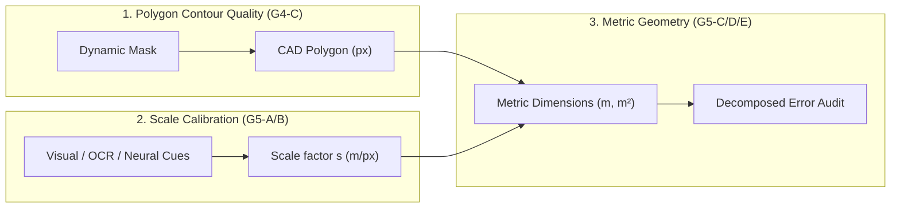
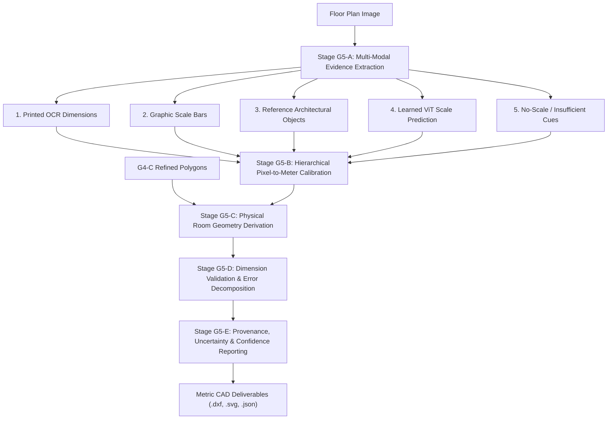
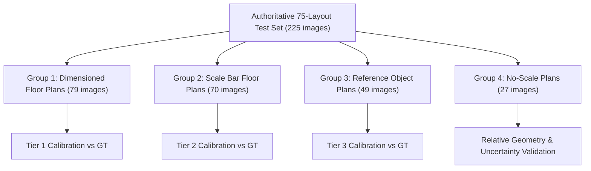

# Experiment G5 Technical Specification: Metric Geometry & Dimension Calibration

> [!IMPORTANT]
> **Status**: Approved Specification for Milestone G5.
> **Role**: Bridges the critical gap between clean CAD vector topology (established in Experiment G4-C) and trustworthy real-world architectural measurements (room dimensions in meters, physical floor areas in $m^2$, and wall lengths).
> **Input Artifacts**: Frozen outputs from Primary Experimental Candidate [`checkpoints/multitask/experiment_g4b_best.pt`](file:///C:/Users/anish/OneDrive/College/Projects/HomeVerse/checkpoints/multitask/experiment_g4b_best.pt) and the deterministic CAD vectorizer [`cad_vectorizer.py`](file:///C:/Users/anish/OneDrive/College/Projects/HomeVerse/cad_vectorizer.py).
> **Strict Operational Constraint**: No neural network weights or query architectures are modified during initial G5 calibration. All evaluations use exact polygon ground truth and enforce strict layout-level train/test separation.

---

## 1. Executive Summary & Root-Cause Analysis

In **Experiment G4-C**, HomeVerse established an end-to-end vectorization pipeline that converted raw dynamic instance masks into valid, topologically consistent CAD polygons:
* Invalid polygon rate dropped from $9.40\%$ to $0.41\%$ (-$95.6\%$ reduction in geometric defects).
* CAD DXF and SVG round-trip geometric integrity reached $100.0\%$.
* Boundary F1 reached $0.8931$ and non-convex interior IoU was preserved at $0.6786$.

However, G4-C exposed a critical remaining limitation:
* **Median Shoelace Area Error remained at $53.55\%$**, offering only a marginal $0.51$ percentage-point improvement over the axis-aligned bounding box baseline ($54.06\%$).

### Orthogonal Geometry Decomposition
To resolve this error, Milestone G5 formalizes the distinction between three fundamentally separate architectural problems:
1. **Polygon Contour Quality**: Structural regularity, corner fidelity, and non-convex preservation (solved by G4-C).
2. **Scale Calibration**: Accurate conversion factor $s$ (meters per pixel) or $\text{PPM}$ (pixels per meter).
3. **Physical Dimension Accuracy**: Metric wall lengths, oriented room dimensions, and physical floor area ($m^2$).



Because room area in square meters scales quadratically with scale:
$$A_{m^2} = A_{px^2} \times s^2$$
A small scale estimation error of $10\%$ compounds into an area error of approximately $21\%$, while a $25\%$ scale error compounds into a $56\%$ area error. Milestone G5 establishes an evidence-backed calibration protocol to isolate, measure, and minimize both linear and quadratic geometric errors.

---

## 2. Milestone G5 Architecture: The 5 Experimental Stages



---

### Stage G5-A: Multi-Modal Scale Evidence Extraction

Stage G5-A extracts and classifies all potential visual scale cues present in the floor-plan image:

1. **Printed Dimension Text (OCR)**:
   - Scans image using OCR text extraction with architectural regex parsers:
     - Imperial: `10'11" x 12'11"`, `10'-5" X 15'-6"`, `11'0" x 14'0"` $\rightarrow$ converted to metric $(W_m, L_m)$.
     - Metric: `3.35 x 4.27`, `3.35m x 4.27m` $\rightarrow$ parsed as $(W_m, L_m)$.
     - Millimeters: `3350 x 4270` $\rightarrow$ converted to $(3.35\,\text{m}, 4.27\,\text{m})$.
   - Records spatial bounding box and centroid of each printed annotation.

2. **Explicit Graphical Scale Bars**:
   - Detects linear horizontal/vertical scale markers with alternating dark/light bands or tick divisions.
   - Extracts pixel length $L_{px}$ between tick marks and parses associated numerical metric label $D_m$ (e.g., $1\,\text{m}$, $2\,\text{m}$, $5\,\text{m}$).

3. **Known-Size Reference Objects (Canonical Priors)**:
   - Detects standard fixed architectural elements and interior fixtures:
     - Standard interior single door swing: nominal clear opening $0.80\,\text{m}\text{--}0.90\,\text{m}$.
     - Standard double/queen bed: nominal width $1.50\,\text{m}$, length $2.00\,\text{m}$.
     - Standard single bed: nominal width $0.90\,\text{m}\text{--}1.00\,\text{m}$, length $1.90\,\text{m}\text{--}2.00\,\text{m}$.
     - Kitchen counter base depth: nominal $0.60\,\text{m}$.
     - Bathtub standard length: nominal $1.50\,\text{m}\text{--}1.70\,\text{m}$.

4. **Learned Scale Head Prediction (ViT Multi-Task Fallback)**:
   - Global scale regression head from G4-B / `scale_estimator.py` predicting $\text{PPM}_{\text{vit}} \in \mathbb{R}^+$ via Softplus activation.

5. **No-Scale / Insufficient Evidence Detection**:
   - Flags floor plans devoid of dimensions, scale bars, identifiable standard fixtures, or where OCR confidence is below verification threshold $\tau_{\text{ocr}} < 0.60$.

---

### Stage G5-B: Hierarchical Pixel-to-Meter Calibration

Stage G5-B resolves scale through a deterministic priority hierarchy to prevent noisy low-confidence heuristics from corrupting high-precision measurements.

#### Mathematical Definitions:
* **Scale factor ($s$)**: meters per pixel ($\text{m/px}$).
* **Pixels per meter ($\text{PPM}$)**: $\text{PPM} = \frac{1}{s}$ ($\text{px/m}$).

#### The Calibration Hierarchy Ladder:

| Priority | Evidence Category | Condition for Activation | Formulation | Scale Provenance | Expected Error |
| :---: | :--- | :--- | :--- | :---: | :---: |
| **Tier 1** | **Matched Dimension Text** | OCR dimension string located within or adjacent to a detected room polygon with matching aspect ratio | $s = \frac{1}{2}\left(\frac{W_m}{W_{px}} + \frac{L_m}{L_{px}}\right)$ | `MEASURED` | $< 3.0\%$ |
| **Tier 2** | **Graphic Scale Bar** | Valid linear bar segment detected with readable numeric label | $s = \frac{D_{\text{bar}, m}}{L_{\text{bar}, px}}$ | `CALIBRATED` | $< 5.0\%$ |
| **Tier 3** | **Reference Objects** | High-confidence fixture detection with verified standard dimensions | $s = \text{median}\left(\frac{D_{\text{ref}, m}}{D_{\text{ref}, px}}\right)$ | `CALIBRATED` | $< 8.0\%$ |
| **Tier 4** | **Learned ViT Prediction** | No explicit or reference cues detected; ViT scale head produces valid output | $s = \frac{1}{\text{PPM}_{\text{vit}}}$ | `ESTIMATED` | $6.0\text{--}10.0\%$ |
| **Tier 5** | **No Scale Information** | Plan lacks all metric cues and ViT scale confidence is uncalibrated | $s = \text{None}$ (Uncalibrated) | `UNAVAILABLE` | N/A |

> [!WARNING]
> **Strict Operational Rule for Tier 5 (No-Scale Plans)**:
> When a floor plan belongs to Group 4 (`no-scale`), HomeVerse **MUST NOT** fabricate or hallucinate absolute metric dimensions ($m$ or $m^2$). It must report exact relative geometry (pixel areas, aspect ratios, normalized coordinates) and explicitly designate metric fields as `UNAVAILABLE`.

---

### Stage G5-C: Physical Room Geometry Derivation

Given a refined 2D closed polygon $P = \{(x_0, y_0), (x_1, y_1), \dots, (x_{N-1}, y_{N-1})\}$ in pixel coordinates and calibrated scale $s$ (m/px):

1. **Polygon Metric Transformation**:
   $$P_m = \{(x_i \cdot s, \, y_i \cdot s) \mid i = 0, \dots, N-1\}$$

2. **Floor Area via Shoelace Formula ($m^2$)**:
   $$A_{m^2} = A_{px^2} \times s^2 = \frac{1}{2} \left| \sum_{i=0}^{N-1} (x_i y_{i+1} - x_{i+1} y_i) \right| \times s^2$$

3. **True Architectural Length ($L_m$) and Width ($W_m$)**:
   Instead of axis-aligned bounding boxes (which falsely inflate dimensions for angled or irregular rooms), compute the **Minimum Area Bounding Rectangle (MABR)** / Oriented Bounding Box:
   $$\text{MABR}(P_m) \rightarrow (L_m, W_m) \quad \text{where } L_m \ge W_m$$

4. **Room Perimeter ($m$)**:
   $$\text{Perimeter}_m = \sum_{i=0}^{N-1} \sqrt{(x_{i+1} - x_i)^2 + (y_{i+1} - y_i)^2} \times s$$

5. **Individual Wall Segment Lengths ($m$)**:
   For each polygon edge $e_i = (p_i, p_{i+1})$:
   $$l_{i, m} = \|p_{i+1} - p_i\|_2 \times s$$

6. **Architectural Form Factors**:
   * **Aspect Ratio**: $\alpha = \frac{L_m}{W_m} \ge 1.0$
   * **Solidity**: $\sigma = \frac{\text{Area}(P_m)}{\text{Area}(\text{ConvexHull}(P_m))} \in (0, 1]$ (identifies alcoves and L-shapes where $\sigma < 0.85$).

---

### Stage G5-D: Dimension Validation & Error Decomposition

To answer the core architectural question—*whether the $53.55\%$ area error originates from segmentation, polygon extraction, scale calibration, or compounding effects*—G5-D executes a rigorous mathematical error decomposition.

#### Mathematical Error Decomposition Formulation:
The ratio of predicted metric area to ground-truth metric area decomposes into:
$$\frac{A_{m^2, \text{pred}}}{A_{m^2, \text{gt}}} = \left(\frac{A_{px^2, \text{pred}}}{A_{px^2, \text{gt}}}\right) \times \left(\frac{s_{\text{pred}}}{s_{\text{gt}}}\right)^2$$

In relative error terms:
$$\epsilon_{\text{area}} = \left(1 + \epsilon_{\text{pixel}}\right) \times \left(1 + \epsilon_{\text{scale}}\right)^2 - 1$$

Where:
* **$\epsilon_{\text{pixel}} = \frac{A_{px^2, \text{pred}} - A_{px^2, \text{gt}}}{A_{px^2, \text{gt}}}$**: Geometric segmentation bias (under-segmentation or over-segmentation independent of scale).
* **$\epsilon_{\text{scale}} = \frac{s_{\text{pred}} - s_{\text{gt}}}{s_{\text{gt}}}$**: Linear pixel-to-meter calibration error.
* **$2 \epsilon_{\text{scale}} + \epsilon_{\text{scale}}^2$**: Quadratic scale magnification factor.

#### The 4-Group Stratified Benchmark Protocol:
All 75 test layouts (225 image variants) must be evaluated across four distinct experimental groups:



1. **Group 1: Dimensioned Floor Plans** ($N = 79$ images):
   - Floor plans containing explicit room dimension callouts.
   - Evaluates OCR extraction, room matching accuracy, and calibrated metric geometry.
2. **Group 2: Scale Bar Floor Plans** ($N = 70$ images):
   - Floor plans containing graphical bar scales.
   - Evaluates scale bar localization, segment measurement, and metric propagation.
3. **Group 3: Reference Object Floor Plans** ($N = 49$ images):
   - Floor plans lacking explicit dimensions but containing standard interior fixtures (doors, beds).
   - Evaluates reference prior scaling and ViT learned scale accuracy.
4. **Group 4: No-Scale Floor Plans** ($N = 27$ images):
   - Floor plans with no metric evidence.
   - Evaluates dimension availability detection, relative geometry preservation, and zero-hallucination compliance.

---

### Stage G5-E: Provenance, Uncertainty & Confidence Reporting

Every generated CAD entity, JSON export, and UI dimension tag must include strict metadata provenance:

```json
{
  "room_id": 3,
  "room_type": "Master Bedroom",
  "functional_parent": "Sleeping Area",
  "dimensions": {
    "length_m": 4.25,
    "width_m": 3.60,
    "area_m2": 15.30,
    "perimeter_m": 15.70,
    "wall_segments_m": [4.25, 3.60, 4.25, 3.60]
  },
  "scale_metadata": {
    "scale_px_per_m": 68.06,
    "provenance": "MEASURED",
    "source_evidence": "OCR text: 14'0\" x 11'10\"",
    "scale_confidence": 0.94
  },
  "geometric_metadata": {
    "polygon_iou_confidence": 0.88,
    "solidity": 1.0,
    "aspect_ratio": 1.18,
    "is_non_convex": false
  },
  "composite_confidence": 0.91,
  "status": "VERIFIED"
}
```

#### Composite Metric Confidence Formula:
$$C_{\text{composite}} = 0.40 \cdot C_{\text{scale}} + 0.35 \cdot C_{\text{poly\_iou}} + 0.15 \cdot C_{\text{det\_conf}} + 0.10 \cdot C_{\text{topology}}$$

Where:
* $C_{\text{scale}}$: $1.0$ for verified OCR match, $0.85$ for scale bar, $0.70$ for reference object, $0.50$ for ViT fallback, $0.0$ for no-scale.
* $C_{\text{poly\_iou}}$: Estimated mask overlap confidence from dynamic query head.
* $C_{\text{det\_conf}}$: Classification score $\max(P_{\text{child}})$.
* $C_{\text{topology}}$: $1.0$ if valid non-self-intersecting polygon with zero collinear defects, $0.5$ if repaired, $0.0$ if invalid.

---

## 3. Evaluation Metrics & Statistical Reporting Standards

To eliminate hiding catastrophic failure modes behind single median values, all G5 evaluations must report:
1. **Median** (robust central tendency)
2. **Mean** (overall aggregate)
3. **P90** ($90^{\text{th}}$ percentile worst-case error)
4. **P95** ($95^{\text{th}}$ percentile tail risk)

### Authoritative G5 Metric Suite:

| Metric | Mathematical Definition | Target (Group 1: OCR) | Target (Group 2: Bar) | Target (Group 3: Ref/ViT) | Target (Group 4: No-Scale) |
| :--- | :--- | :---: | :---: | :---: | :---: |
| **Scale Estimation MAPE** | $\frac{1}{N} \sum \frac{\|s_{\text{pred}} - s_{\text{gt}}\|}{s_{\text{gt}}} \times 100\%$ | $\le 3.0\%$ | $\le 5.0\%$ | $\le 8.0\%$ | N/A (Designated `None`) |
| **Room Length MAE** | $\frac{1}{M} \sum \|L_{\text{pred}} - L_{\text{gt}}\|$ (meters) | $\le 0.20\,\text{m}$ | $\le 0.30\,\text{m}$ | $\le 0.45\,\text{m}$ | N/A |
| **Room Width MAE** | $\frac{1}{M} \sum \|W_{\text{pred}} - W_{\text{gt}}\|$ (meters) | $\le 0.20\,\text{m}$ | $\le 0.30\,\text{m}$ | $\le 0.45\,\text{m}$ | N/A |
| **Room Area MAPE** | $\frac{1}{M} \sum \frac{\|A_{m^2, \text{pred}} - A_{m^2, \text{gt}}\|}{A_{m^2, \text{gt}}} \times 100\%$ | $\le 8.0\%$ | $\le 12.0\%$ | $\le 18.0\%$ | N/A |
| **Room Perimeter MAE**| $\frac{1}{M} \sum \|\text{Perim}_{\text{pred}} - \text{Perim}_{\text{gt}}\|$ (m) | $\le 0.80\,\text{m}$ | $\le 1.20\,\text{m}$ | $\le 1.80\,\text{m}$ | N/A |
| **Wall Segment MAE** | $\frac{1}{K} \sum \|l_{k, \text{pred}} - l_{k, \text{gt}}\|$ (meters) | $\le 0.25\,\text{m}$ | $\le 0.35\,\text{m}$ | $\le 0.50\,\text{m}$ | N/A |
| **Dimension Availability**| $\frac{\text{Correctly Classified (Measurable vs Unavailable)}}{\text{Total Floor Plans}}$ | $\ge 98.0\%$ | $\ge 98.0\%$ | $\ge 98.0\%$ | $\ge 98.0\%$ |
| **Calibration Coverage** | $\frac{\text{Calibrated Layouts}}{\text{Eligible Layouts}}$ | $\ge 85.0\%$ | $\ge 90.0\%$ | $\ge 95.0\%$ | $0.0\%$ (Strict non-hallucination) |

---

## 4. Acceptance Criteria & Stop/Go Thresholds

Milestone G5 must satisfy the following strict criteria before progressing to property-level cost and area modeling (Milestone G6):

1. **Error Decomposition Verification**:
   - The evaluation must definitively isolate the percentage of the $53.55\%$ area error attributable to:
     - Pure pixel segmentation / contour extraction ($\Delta A_{px^2}$)
     - Scale calibration error ($\Delta s$)
     - Quadratic magnification ($2 \Delta s + \Delta s^2$)
2. **Dimensioned Plan Accuracy**:
   - For floor plans with readable printed dimensions (Group 1), median room area error must drop below **$10.0\%$** (down from $53.55\%$).
3. **Scale Bar Accuracy**:
   - For floor plans with graphic scale bars (Group 2), median scale estimation error must be below **$5.0\%$**.
4. **Zero-Hallucination Compliance**:
   - In Group 4 (`no-scale`), $100.0\%$ of layouts must correctly flag metric dimensions as `UNAVAILABLE` without manufacturing fictitious metric values.
5. **CAD Export Enrichment**:
   - DXF and SVG outputs must include layer-separated metric text annotations ($L \times W\,\text{m}$, Area in $m^2$) alongside the closed polygon polylines.

---

## 5. Implementation Roadmap & Execution Plan

| Step | Task Name | Key Deliverables | Status |
| :---: | :--- | :--- | :---: |
| **Step 1** | **Spec Approval & Freezing** | Finalize `docs/architecture/g5_metric_geometry_spec.md` | **Ready** |
| **Step 2** | **Multi-Modal Scale Engine** | Implement `metric_calibrator.py` (OCR, scale bar, reference object, ViT fallback) | Pending |
| **Step 3** | **Physical Geometry Derivation** | Implement `metric_geometry.py` (MABR oriented box, wall segments, Shoelace $m^2$) | Pending |
| **Step 4** | **Benchmark Evaluation Runner** | Implement `run_experiment_g5.py` across 75 test layouts (225 images, Groups 1-4) | Pending |
| **Step 5** | **Comprehensive Audit Report** | Author `experiment_g5_report.md` with error decomposition and P90/P95 tail risks | Pending |
