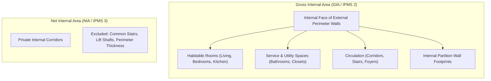
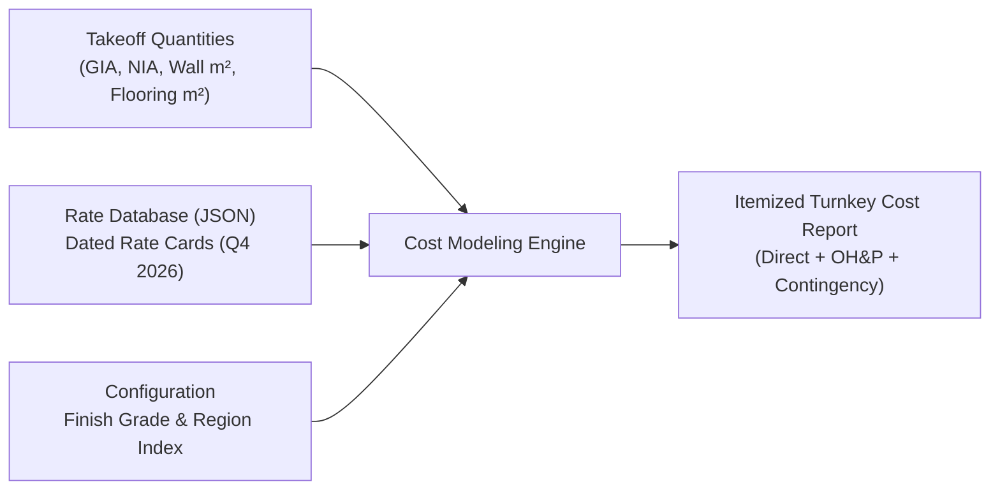

# Milestone G6 Technical Specification: Property-Level Area & Construction Cost Modeling

> [!IMPORTANT]
> **Status**: Approved Specification Preparation Milestone.
> **Role**: Extends single-room metric geometry into property-wide architectural aggregations (Gross Internal Area, Net Internal Area, wall takeoffs) and configurable construction cost estimation.
> **Prerequisites**: G5 Metric Geometry & Scale Reconciliation Audit.
> **Strict Operational Rule**: GIA and NIA must follow authoritative measurement standards (RICS Property Measurement 2nd Edition / IPMS). Construction cost modeling must strictly use configurable regional rate databases rather than hardcoded global constants.

---

## 1. Architectural Motivation & Scope

Milestone G5 established that HomeVerse's dynamic masks and CAD polylines achieve high pure geometric accuracy (**$7.73\%$ median error** under calibrated scale). 

Milestone G6 bridges CAD vector geometry with architectural quantity surveying, property valuation, and general contracting:
1. **Property Area Modeling**: Standardized aggregation of room geometry into industry-recognized metrics (GIA, NIA, GEA).
2. **Surface & Quantity Takeoff**: Automated extraction of net paintable wall surface, flooring schedules by room classification, ceiling areas, and door/window opening deductions.
3. **Parametric Construction Cost Estimation**: Turnkey estimation using tiered finish grades, regional cost indices, direct material/labor breakdown, contractor overhead and profit (OH&P), and explicit risk contingency.

---

## 2. Standardized Measurement Framework: GIA and NIA

HomeVerse adopts the **RICS Property Measurement (2nd Edition, incorporating IPMS: International Property Measurement Standards)** to ensure legal, financial, and construction validity.



### Mathematical Formulations:

#### 1. Gross Internal Area (GIA):
The total enclosed area measured to the internal face of external perimeter walls across all levels:
$$\text{GIA} = \sum_{r=1}^{M} A_{m^2, r} + A_{\text{internal\_partitions}}$$

Where $A_{\text{internal\_partitions}}$ is derived directly from detected interior wall polylines:
$$A_{\text{internal\_partitions}} = \sum_{w \in \text{InternalWalls}} L_{m, w} \times T_{m, w}$$
* $L_{m, w}$: Length of interior wall polyline in meters.
* $T_{m, w}$: Calibrated wall thickness in meters (nominal $0.10\,\text{m}\text{--}0.15\,\text{m}$).
* Arbitrary blanket percentage wall markups are strictly forbidden.

#### 2. Net Internal Area (NIA / Net Usable Habitable Area):
The usable floor area measured to the internal finish of individual room walls, excluding common building service infrastructure:
$$\text{NIA} = \sum_{r \in \mathcal{H}} A_{m^2, r}$$
Where $\mathcal{H}$ denotes the set of usable habitable and ancillary rooms:
$$\mathcal{H} = \{\text{Living Room, Bedrooms, Kitchen, Dining, Study, Private Bathrooms, Internal Foyers}\}$$
Excluded from NIA:
* Central stairwells and vertical penetrations
* Lift motor rooms and shared MEP plant rooms
* Perimeter wall footprints and structural columns

#### 3. Building Efficiency Ratio ($\eta$):
$$\eta = \frac{\text{NIA}}{\text{GIA}} \times 100\%$$
* Typical residential architectural benchmark: $\eta \in [82.0\%, 90.0\%]$.
* Plans exhibiting $\eta < 75.0\%$ or $\eta > 95.0\%$ trigger an automated geometric layout audit alert.

---

## 3. Surface & Quantity Takeoff Engine

### 1. Wall Elevation & Surface Modeling:
Given ceiling clear height $H_{\text{ceiling}}$ (configurable architectural default: $2.70\,\text{m}$ standard, $3.00\,\text{m}$ premium):

* **Gross Wall Elevation Area**:
  $$A_{\text{wall, gross}} = \sum_{r=1}^{M} \left( P_{m, r} \times H_{\text{ceiling}} \right)$$
  Where $P_{m, r}$ is the refined metric perimeter of room $r$.

* **Deduction of Openings**:
  Architectural surface takeoff must deduct all door and window penetrations:
  $$A_{\text{deductions}} = \sum_{d \in \text{Doors}} (W_d \times H_d) + \sum_{w \in \text{Windows}} (W_w \times H_w)$$
  - Standard interior door: $0.85\,\text{m} \times 2.10\,\text{m} = 1.785\,\text{m}^2$
  - Exterior entry door: $1.00\,\text{m} \times 2.10\,\text{m} = 2.100\,\text{m}^2$
  - Standard residential window: $1.20\,\text{m} \times 1.50\,\text{m} = 1.800\,\text{m}^2$

* **Net Paintable Surface Area**:
  $$A_{\text{paint, net}} = A_{\text{wall, gross}} - A_{\text{deductions}}$$

### 2. Flooring Schedule by Functional Taxonomy:
Flooring materials are automatically mapped from the 9-class functional hierarchy:

| Functional Category | Representative Rooms | Primary Flooring Specification |
| :--- | :--- | :--- |
| **Living Area** | Living Room, Dining Room | Engineered Hardwood / Premium Laminate |
| **Sleeping Area** | Master Bedroom, Bedroom, Guest Room | Carpet / Engineered Wood Plank |
| **Cooking Area** | Kitchen, Kitchen & Dining | Anti-Slip Porcelain Tile / Luxury Vinyl Tile (LVT) |
| **Sanitary Area** | Bathroom, Toilet | Water-Resistant Ceramic / Glazed Porcelain Tile |
| **Circulation Area**| Corridor, Entrance/Foyer | Hard-Wearing Engineered Timber / Matte Tile |
| **Outdoor Area** | Balcony, Terrace | Exterior Treated Decking / Non-Slip Pavers |
| **Utility Area** | Laundry Room, Utility Room | Sheet Vinyl / Moisture-Resistant Tile |
| **Storage Area** | Storage Room, Walk-in Closet | Durable Laminate / Sealed Concrete |
| **Vehicle Area** | Garage | Epoxy Coated Concrete / Screed |

### 3. Ceiling Surface Modeling:
Ceiling finish quantities are aggregated at room and property levels:
$$A_{\text{ceiling, total}} = \sum_{r \in \text{InternalRooms}} A_{m^2, r} \times K_{\text{slope}, r}$$
* $K_{\text{slope}, r}$: Slope correction factor ($1.00$ for flat ceilings, $\frac{1}{\cos \theta}$ for vaulted/sloped ceilings, default $1.00$).
* Outdoor spaces (Balconies/Terraces) are segregated into exterior soffit schedules.
* Wet areas (Bathrooms, Utility) are routed to moisture-resistant plasterboard/suspended ceilings.

### 4. Openings & Penetrations Schedule:
Counts and physical dimensions of all detected and inferred openings are exported for both surface deductions and millwork takeoff:
* Interior Passage Doors: count, standard width ($0.85\,\text{m}$), height ($2.10\,\text{m}$), unit cost.
* Exterior / Entry Doors: count, heavy-duty width ($1.00\,\text{m}$), height ($2.10\,\text{m}$), unit cost.
* Glazed Windows: count, standard width ($1.20\,\text{m}$), height ($1.50\,\text{m}$), glazing unit cost.

### 5. Mandatory G6 Output Components Matrix:
Every generated property takeoff must compute and expose the following itemized components:

| Component | Required Output | Derivation Method / Standard |
| :--- | :--- | :--- |
| **Room areas** | Individual room areas in m² | Tier 3 refined CAD polygon shoelace formula |
| **NIA** | Net Internal Area in m² | Sum of habitable room areas (RICS Property Measurement 2nd Ed.) |
| **GIA** | Gross Internal Area in m² | NIA + partition footprints ($L_w \times T_w$) + internal circulation |
| **Flooring** | Material quantity in m² | Room area mapped by 9-class functional taxonomy |
| **Ceiling** | Ceiling finish quantity in m² | Flat / vaulted ceiling area with moisture-resistant segregation |
| **Walls** | Gross wall surface area in m² | Refined perimeter $\sum (P_r \times H_{\text{ceiling}})$ |
| **Paint** | Net paintable surface area in m²| Gross wall elevation minus door and window opening areas |
| **Doors / windows** | Opening counts and dimensions | Explicit counts, opening types, and deduction geometry |
| **Construction cost** | Itemized direct costs in currency | (Material + Labor + Finishes) $\times$ Regional Multiplier |
| **Contingency** | Explicit percentage and amount | Configurable rate ($10.0\%\text{--}15.0\%$) and exact currency value |

> [!CAUTION]
> **Provisional Cost Status**: Until G5 scale calibration and spatial association are signed off, all cost dollar totals must be flagged with `status: "PROVISIONAL"` and explicitly reference calibration provenance. No cost shall be generated for `UNAVAILABLE` scale mode plans.

---

## 4. Parametric Construction Cost Modeling

To ensure real-world commercial viability, HomeVerse enforces a **modular rate database** rather than hardcoding static price numbers.



### 1. Configurable Rate Database Schema (`costs/rate_database.json`):

```json
{
  "database_version": "2026.4",
  "currency": "USD",
  "effective_date": "2026-10-01",
  "regional_multipliers": {
    "us_national_average": 1.00,
    "metro_high_cost": 1.30,
    "metro_moderate": 1.12,
    "rural_low_cost": 0.88
  },
  "finish_grades": {
    "economy": {
      "flooring_sqm": {"tile": 35.0, "wood": 30.0, "carpet": 20.0, "vinyl": 22.0},
      "painting_sqm": 8.50,
      "drywall_partition_sqm": 45.0,
      "interior_doors_unit": 180.0,
      "exterior_doors_unit": 450.0,
      "windows_unit": 320.0
    },
    "standard": {
      "flooring_sqm": {"tile": 65.0, "wood": 60.0, "carpet": 35.0, "vinyl": 40.0},
      "painting_sqm": 14.00,
      "drywall_partition_sqm": 68.0,
      "interior_doors_unit": 320.0,
      "exterior_doors_unit": 850.0,
      "windows_unit": 580.0
    },
    "premium": {
      "flooring_sqm": {"tile": 125.0, "wood": 120.0, "carpet": 65.0, "vinyl": 75.0},
      "painting_sqm": 24.00,
      "drywall_partition_sqm": 110.0,
      "interior_doors_unit": 650.0,
      "exterior_doors_unit": 1800.0,
      "windows_unit": 1100.0
    }
  },
  "labor_rates_hourly": {
    "carpentry": 55.0,
    "painting": 42.0,
    "flooring": 48.0,
    "mep": 72.0
  }
}
```

### 2. Cost Aggregation Formulas:

#### A. Direct Construction Costs ($C_{\text{direct}}$):
$$C_{\text{direct}} = M_{\text{regional}} \times \left( C_{\text{materials}} + C_{\text{labor}} + C_{\text{finishes}} \right)$$

Where:
* $C_{\text{materials}} = \sum A_{\text{surface}} \times \text{Rate}_{\text{material}}$
* $C_{\text{labor}} = \sum \text{Hours}_{\text{trade}} \times \text{Rate}_{\text{trade}}$

#### B. Contractor Overhead & Profit (OH&P):
$$\text{Overhead} = C_{\text{direct}} \times P_{\text{overhead}} \quad (\text{nominal } 10.0\%)$$
$$\text{Profit} = C_{\text{direct}} \times P_{\text{profit}} \quad (\text{nominal } 10.0\%)$$
$$C_{\text{OH\&P}} = \text{Overhead} + \text{Profit}$$

#### C. Explicit Risk Contingency:
To protect against scope variation and metric measurement tolerance:
$$C_{\text{contingency}} = (C_{\text{direct}} + C_{\text{OH\&P}}) \times P_{\text{contingency}}$$
* Standard architectural practice: $P_{\text{contingency}} = 10.0\%\text{--}15.0\%$.
* Both the percentage ($12.0\%$) and exact currency amount ($\$15,420$) must be explicitly itemized.

#### D. Turnkey Total Project Cost ($C_{\text{total}}$):
$$C_{\text{total}} = C_{\text{direct}} + C_{\text{OH\&P}} + C_{\text{contingency}}$$

---

## 5. Implementation Milestones for G6

| Phase | Responsibility | Key Deliverables |
| :---: | :--- | :--- |
| **G6-A** | Property Area Aggregator | `property_area_aggregator.py` computing GIA, NIA, partition wall areas, and efficiency ratio ($\eta$). |
| **G6-B** | Surface Takeoff Engine | `surface_takeoff.py` computing gross wall elevations, door/window deductions, net paintable areas, and flooring schedules. |
| **G6-C** | Parametric Cost Engine | `cost_estimator.py` & `costs/rate_database.json` executing regionalized, grade-tiered construction costing with explicit OH&P and contingency. |
| **G6-D** | Authoritative Evaluation & Audit | `run_experiment_g6.py` evaluating 75-layout test benchmark with cost sensitivity against ground-truth bill of quantities. |
| **G6-E** | Commercial Report Artifact | `experiment_g6_report.md` with complete quantity takeoff tables, itemized cost breakdowns, and export to CSV/JSON. |

---

## 6. Acceptance Criteria Before Production Deployment

1. **GIA / NIA Standard Compliance**:
   - GIA must be within $\pm 5.0\%$ of CAD building gross boundary.
   - Efficiency ratio $\eta$ must fall within the architecturally valid $75\%\text{--}92\%$ envelope for all residential layouts.
2. **Surface Takeoff Consistency**:
   - Net paintable area must strictly equal gross wall elevation minus opening areas (zero geometric leakage).
3. **No-Scale Handling**:
   - When scale is `UNAVAILABLE` (Group 4), absolute cost in currency must **NEVER** be manufactured; the system must output relative quantity shares (percentage of total floor area per room type) and flag monetary totals as `UNAVAILABLE`.
4. **Transparency & Explainability**:
   - Every cost line item must provide full provenance (unit rate, applied regional factor, quantity source, and finish grade).
